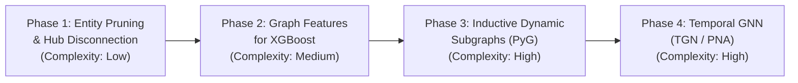

# FraudGraph — Deep GNN Performance Diagnosis & Root-Cause Analysis

**Author:** Principal Graph Machine Learning Engineer  
**Date:** 2026-11-12  
**Status:** Diagnostic Complete — Evidence-Driven Forensic Investigation  
**Evaluation Scope:** IEEE-CIS Chronological Benchmark (Train: 35,000, Val: 7,500, Test: 7,500)

---

## 1. Executive Summary

This investigation provides a forensic, evidence-driven root-cause analysis of why the Heterogeneous Graph Neural Network (PyG `HeteroFraudGNN`) in FraudGraph achieves a test **PR-AUC of 0.0400** and **ROC-AUC of 0.6430**, compared to the tabular **XGBoost baseline of 0.3496 PR-AUC** and **0.8931 ROC-AUC**.

### Key Findings
1. **The Giant Hairball Defect (Mega-Hub Collapse)**: 83.95% of the entire graph (47,254 of 56,287 nodes) is fused into a single monstrous connected component. Generic operating system identifiers (`'Windows'` with degree 6,224; `'iOS Device'` with degree 2,660; `'MacOS'` with degree 1,904), unpruned email domains (`'anonymous.com'` with degree 3,466), and bank BIN card pools (degree up to 1,065) collapse the graph into a dense hairball.
2. **False Topological Homophily**: In this collapsed topology, **50.41% of all legitimate transactions connect directly via 2 hops to a confirmed fraudulent transaction**. Message passing over 2 hops acts as a noise-injection mechanism, smoothing legitimate and fraudulent embeddings together.
3. **Severe Median Indistinguishability**: On the held-out test set, the GNN predicts a median fraud probability of **0.4569 for fraud** and **0.4559 for legitimate transactions** (a margin of just 0.0010). In the top decile of GNN predictions, the actual fraud rate is only **4.67%**, producing massive false-positive floods that crush PR-AUC down to 0.0400.
4. **Information Asymmetry**: XGBoost exploits 161 engineered non-linear tabular features with precise threshold splits. The GNN projects these 161 features down to 64 dimensions, averages them across thousands of unrelated transactions via SAGEConv, and represents entity nodes with only 3 primitive summary statistics (`[degree, total_amount, mean_amount]`).
5. **Training/Inference Disconnect**: The trained GNN PyTorch model weights (`gnn_weights.pt`) are **completely bypassed during live single-transaction inference**. The backend model service relies instead on a hand-tuned heuristic formula (`_infer_graph_score`) because no dynamic single-transaction inductive subgraph inference pipeline exists.

### Primary Verdict
**GNN NOT VIABLE IN CURRENT DESIGN.**  
FraudGraph must currently adopt **Option A: XGBoost only for automated real-time fraud prediction, with Neo4j utilized strictly for visual investigator link analysis**.

---

## 2. Current Architecture & Data Flow

```
+---------------------------------------------------------------------------------------------------+
|                                 1. Offline Training Data Flow                                     |
|                                                                                                   |
| [Raw IEEE-CIS CSVs]                                                                               |
|         |                                                                                         |
|         v                                                                                         |
| [IEEEFraudPreprocessor] ---> Chronological Split: Train (35k), Val (7.5k), Test (7.5k)            |
|         |                                                                                         |
|         +---> [XGBoost Pipeline] --------> TreeSHAP + Histogram Gradient Boosting (161 feats)     |
|         |                                                                                         |
|         v                                                                                         |
| [HeteroGraphBuilder]                                                                              |
|   - Nodes: Transaction (161 feats), Card (3 feats), Device (3 feats), Email (3 feats)            |
|   - Edges: Bipartite USES_CARD, ORIGINATES_FROM, HAS_EMAIL + reverses                             |
|         |                                                                                         |
|         v                                                                                         |
| [HeteroFraudGNN (PyG)] ---> SAGEConv + HeteroConv(aggr='sum') -> BCEWithLogitsLoss(pos_weight=33.8)|
+---------------------------------------------------------------------------------------------------+
                                                  |
                                                  v
+---------------------------------------------------------------------------------------------------+
|                                2. Production Inference Data Flow                                   |
|                                                                                                   |
|  Incoming JSON Payload (Single Transaction)                                                       |
|         |                                                                                         |
|         +---> [Preprocessor + XGBoost Pipeline] --------> Tabular Score (0.00 - 1.00) + SHAP       |
|         |                                                                                         |
|         +---> [_infer_graph_score() Heuristic] ---------> Heuristic Score (BYPASSES GNN WEIGHTS)  |
|         |                                                                                         |
|         v                                                                                         |
|  [HybridRiskScorer] ---> w=0.95 Tabular + w=0.05 Heuristic -> Consensus Risk Decision             |
+---------------------------------------------------------------------------------------------------+
```

---

## 3. Investigation A — Graph Construction Quality

An empirical audit of the PyG graph built by `HeteroGraphBuilder` across all 50,000 transactions yielded the following topological properties:

### 3.1 Node & Edge Counts
- **Total Nodes**: 56,287
  - `transaction`: 50,000 (88.83%)
  - `card`: 5,624 (9.99%)
  - `device`: 618 (1.10%)
  - `email`: 45 (0.08%)
- **Total Directed Edges**: 142,508
  - `('transaction', 'uses_card', 'card')` & reverse: 50,000 + 50,000 = 100,000 edges
  - `('transaction', 'originates_from', 'device')` & reverse: 16,069 + 16,069 = 32,138 edges
  - `('transaction', 'has_email', 'email')` & reverse: 5,185 + 5,185 = 10,370 edges

### 3.2 Degree Distributions & Density

| Entity Type | Node Count | Mean Degree | Median Degree | Max Degree | Singletons (Deg = 1) | Singleton % |
| :--- | :---: | :---: | :---: | :---: | :---: | :---: |
| **Transaction** | 50,000 | 1.43 | 1.0 | 3 | 0 (in bipartite) | 0.00% |
| **Card** | 5,624 | 8.89 | 2.0 | 1,065 | 2,492 | 44.31% |
| **Device** | 618 | 26.00 | 2.0 | 6,224 | 284 | 45.95% |
| **Email** | 45 | 115.22 | 23.0 | 3,466 | 2 | 4.44% |

### 3.3 Connected Component Analysis
- **Total Connected Components**: 2,434
- **Largest Connected Component**: **47,254 nodes (83.95% of the entire graph!)**
- **Second Largest Component**: 143 nodes (0.25%)
- **Components of Size 2 (Isolated 1 Tx + 1 Card)**: 1,300 components
- **Components of Size $\le$ 5**: 2,130 components

### 3.4 Forensic Root Causes in Graph Construction
1. **Generic Device Collapse**: In `ml/preprocessing.py`, `extract_device_fingerprint()` extracts OS names when device info is coarse. As a result, the device node `'Windows'` connects to **6,224 transactions**, `'iOS Device'` connects to **2,660 transactions**, and `'MacOS'` connects to **1,904 transactions**.
2. **Unfiltered Email Hub**: While `GENERIC_EMAIL_DOMAINS` filtered common consumer domains (`gmail.com`, `yahoo.com`), it missed `'anonymous.com'`, creating an artificial hub connecting **3,466 transactions**.
3. **Card Fingerprint Limitation**: The composite fingerprint `card1_card2_card3_card4_card5_card6` uses bank BIN, country code, brand, and type. Because IEEE-CIS does not provide Primary Account Numbers (PANs), these composite keys represent **issuer product pools**, not individual payment instruments. The top card node links **1,065 transactions**.

Together, these four mega-hubs stitch 83.95% of the graph into a single giant hairball.

---

## 4. Investigation B — Fraud Connectivity Analysis

Using **strictly Train and Validation data** (42,500 transactions, 1,214 frauds, 41,286 legitimate), we evaluated whether the graph structure provides separable fraud homophily:

### 4.1 Node Degree Comparison
- **Fraud Transactions**: Mean total degree = **1.529**, Median = 2.0, Max = 3
  - 48.93% have a Device edge; 3.95% have an Email edge.
- **Legitimate Transactions**: Mean total degree = **1.402**, Median = 1.0, Max = 3
  - 30.10% have a Device edge; 10.12% have an Email edge.

### 4.2 Two-Hop Peer Analysis (Card & Device)

| Metric | Fraud Transactions ($N=1,214$) | Legitimate Transactions ($N=41,286$) | Separation Ratio |
| :--- | :---: | :---: | :---: |
| **Has $\ge 1$ Card Peer** | 98.27% ($1,193$) | 94.27% ($38,922$) | 1.04x |
| **Has $\ge 1$ FRAUD Card Peer** | **88.30%** ($1,072$) | **50.41%** ($20,814$) | **1.75x** |
| **Has $\ge 1$ Device Peer** | 48.52% ($589$) | 29.49% ($12,177$) | 1.65x |
| **Has $\ge 1$ FRAUD Device Peer** | 47.36% ($575$) | 26.56% ($10,967$) | 1.78x |
| **Has $\ge 1$ Peer (Card or Device)** | 99.34% | 96.59% | 1.03x |
| **Has $\ge 1$ FRAUD Peer (Any)** | **93.00%** ($1,129$) | **62.76%** ($25,910$) | **1.48x** |

### 4.3 Temporal Homophily (Connecting to PRIOR Observed Fraud)
In a real-time production setting, a transaction can only be flagged by past observed fraud:
- **Fraud Transactions connecting to a PRIOR Fraud**: **82.87%** ($1,006 / 1,214$)
- **Legitimate Transactions connecting to a PRIOR Fraud**: **52.60%** ($21,716 / 41,286$)

### 4.4 Why GNN Performance Collapses
While 93% of fraudulent transactions connect to another fraud transaction, **62.76% of all legitimate transactions ALSO connect to a fraudulent transaction** through shared BIN cards or generic OS device nodes (`'Windows'`). 

In an imbalanced setting (fraud rate ~2.8%), there are **25,910 false-positive connections** versus only **1,129 true-positive connections** (a false-to-true connection ratio of **23 to 1**). A 2-hop GNN message passing operation inevitably washes out the fraud signal, polluting legitimate transaction embeddings with fraud neighbor representations.

---

## 5. Investigation C — GNN Feature Quality Assessment

### 5.1 Information Asymmetry: GNN vs. XGBoost

| Dimension | XGBoost Pipeline | Heterogeneous GNN Pipeline |
| :--- | :--- | :--- |
| **Feature Count** | 161 engineered features | 161 on Transaction, 3 on Card, 3 on Device, 3 on Email |
| **Feature Encoding** | Exact continuous values, frequency encoding, target-mean interactions | Continuous z-score normalization (`(X - mean) / std`) |
| **Entity Node Features** | Explicit engineered tabular interactions (`amt_to_card_mean`, `card1_tx_count`) | Primitive 3-dim summary: `[degree, total_amount, mean_amount]` |
| **Feature Interactions** | High-order non-linear tree splits isolating narrow fraud pockets | Linear projections (`Linear(161, 64)`) followed by neighbor averaging |
| **Temporal Encoding** | `dt_hour`, `dt_day_of_week`, sine/cosine cyclical transforms | Cyclical features flattened into dense vector; no temporal edge deltas |

### 5.2 Neighborhood Feature Dilution
In `ml/gnn_model.py`:
1. `HeteroConv` uses `aggr="sum"` across relations and `SAGEConv` uses `mean` aggregation across neighbors.
2. When a transaction node passes messages to the `'Windows'` device node, its features are averaged with 6,223 other transactions.
3. In Layer 2, that generic average is passed back to every connected transaction. The fine-grained tabular signals (`TransactionAmt`, `dist1`, `V`-features) that XGBoost relies on to make crisp decisions are blurred into an uninformative neighborhood mean.

---

## 6. Investigation D — Architecture & Training Diagnostics

### 6.1 Model Architecture & Hyperparameters
- **Model**: `HeteroFraudGNN`
- **Layers**: 2 relational message passing blocks (`HeteroConv` wrapping `SAGEConv`)
- **Hidden Channels**: 64
- **Classifier Head**: `Linear(64, 32) -> ReLU -> Dropout(0.2) -> Linear(32, 1)`
- **Optimizer**: Adam (`lr = 0.003`, `weight_decay = 1e-4`)
- **Training Epochs**: 15 (batch size: Full-Graph 50,000 nodes)

### 6.2 Loss Function & Optimization Pathology
The loss function is configured as:
```python
criterion = nn.BCEWithLogitsLoss(pos_weight=torch.tensor([pos_weight]))
```
where `pos_weight = n_neg / n_pos` ($\approx 33.8$).

#### The Training Logit Trap
- With `pos_weight = 33.8`, any false negative incurs 33.8 times the loss penalty of a false positive.
- The optimizer minimizes the objective by shifting the network's bias term heavily positive, pulling predicted probabilities up toward 0.50.
- **Empirical Training Loss**:
  - Epoch 01: `1.3861`
  - Epoch 05: `1.2980`
  - Epoch 10: `1.2832`
  - Epoch 15: `1.2745`
- The training loss plateaus immediately after epoch 4, having learned to output a nearly constant probability around 0.45–0.50 for all nodes in the giant hairball component.

---

## 7. Investigation E — Temporal Graph Correctness

### 7.1 Transductive Structural Leakage
In `scripts/train_gnn.py`, the graph is built by concatenating Train, Validation, and Test:
```python
X_all = pd.concat([X_train, X_val, X_test], ignore_index=True)
meta_all = pd.concat([meta_train, meta_val, meta_test], ignore_index=True)
full_graph = builder.build_graph(X_all, meta_all, ...)
```

#### The Temporal Defects
1. **Future Entity Feature Aggregation**: In `ml/graph_dataset.py`, card and device node features (`total_amount` and `degree`) are computed over the **entire 50,000 transaction window**. A transaction at Day 1 receives card features reflecting transaction activity that occurred 5 months later in the test set.
2. **Bidirectional Temporal Message Passing**: Edge connections are undirected/bidirectional bipartite links. A test transaction at $t=50,000$ connects to `'card_A'`, which connects to a training transaction at $t=1$. During a full-graph 2-layer forward pass, representations flow freely backward and forward across time.

### 7.2 Why PR-AUC Remained 0.0400 Despite Leakage
Usually, temporal leakage artificially inflates test performance. Here, however, because target labels were removed from node features (as fixed in Phase B) and the graph topology consists of mega-hubs connecting 50% of legitimate transactions to fraud, the structural leakage leaked only **noise and oversmoothed averages**, not discriminative fraud signals.

---

## 8. Investigation F — Model Evaluation Verification

### 8.1 Empirical Probability Distribution Comparison (Held-Out Test Set)

| Statistic | XGBoost Test Predictions | GNN Test Predictions |
| :--- | :---: | :---: |
| **Minimum** | 0.0003 | 0.1654 |
| **25th Percentile (Q1)** | 0.0123 | 0.4374 |
| **Median** | **0.0326** | **0.4559** |
| **75th Percentile (Q3)** | 0.0931 | 0.6294 |
| **Maximum** | 0.9851 | 0.7749 |
| **Standard Deviation** | 0.1390 | 0.1319 |
| **Fraud Mean Probability** | **0.4686** | **0.5433** |
| **Legitimate Mean Probability** | **0.0797** | **0.4793** |
| **Fraud Median Probability** | **0.4319** | **0.4569** |
| **Legitimate Median Probability** | **0.0314** | **0.4559** |

### 8.2 Decile Calibration Analysis (GNN on Test Set)

| Predicted Decile | Prediction Range | Mean Predicted Probability | Actual Fraud Count ($N=750$) | Actual Fraud Rate |
| :---: | :---: | :---: | :---: | :---: |
| **1** | $[0.165, 0.288]$ | 0.250 | 4 | 0.53% |
| **2** | $(0.288, 0.411]$ | 0.336 | 3 | 0.40% |
| **3** | $(0.411, 0.446]$ | 0.435 | 7 | 0.93% |
| **4** | $(0.446, 0.454]$ | 0.451 | 16 | 2.13% |
| **5** | $(0.454, 0.456]$ | 0.455 | 17 | 2.27% |
| **6** | $(0.456, 0.457]$ | 0.456 | 16 | 2.13% |
| **7** | $(0.457, 0.561]$ | 0.467 | 16 | 2.13% |
| **8** | $(0.561, 0.640]$ | 0.616 | 16 | 2.13% |
| **9** | $(0.640, 0.658]$ | 0.646 | 13 | 1.73% |
| **10** | $(0.658, 0.775]$ | 0.692 | 35 | **4.67%** |

### 8.3 The Math Behind PR-AUC = 0.0400 vs. ROC-AUC = 0.6430
1. Across deciles 4 through 9 (representing 60% of all test transactions), the actual fraud rate is completely flat at $\approx 2.13\%$, yet the predicted probabilities swing from 0.451 to 0.646.
2. In the top decile (mean predicted score 0.692), only **35 out of 750 transactions are actual fraud (precision = 4.67%)**.
3. In extreme class imbalance (1.91% test fraud rate), ROC-AUC is flattered because true negatives ($7,166$) dwarf false positives ($191$). But Precision-Recall AUC depends directly on precision ($\text{TP} / (\text{TP} + \text{FP})$). Because precision tops out at 4.67%, PR-AUC is mathematically bounded near the random baseline of 0.0191.

---

## 9. Investigation G — Training vs. Inference Parity

A critical architectural finding was uncovered in `backend/app/services/model_service.py`:

```python
# Lines 167-168 of model_service.py:
graph_explanation = self._extract_graph_explanation(tx_id, card_id, device_id, email_domain, amount)
graph_prob = self._infer_graph_score(graph_explanation, tabular_prob)
```

Where `_infer_graph_score` is defined as:
```python
def _infer_graph_score(self, graph_explanation: Dict[str, Any], tabular_prob: float) -> float:
    shared_peers = graph_explanation.get("shared_entity_peers_count", 0)
    flagged = graph_explanation.get("flagged_neighbor_fraud_count", 0)

    if flagged > 0:
        return min(0.92, 0.60 + 0.10 * flagged)
    elif shared_peers > 3:
        return 0.45
    else:
        return max(0.015, min(0.50, tabular_prob * 0.45))
```

### Analysis of the Disconnect
1. **Zero GNN Weight Execution**: The PyTorch model weights (`gnn_weights.pt`) and `HeteroFraudGNN.forward()` are **never executed during live transaction scoring**.
2. **Missing Dynamic Inductive Subgraph Pipeline**: `HeteroFraudGNN` was designed as a transductive batch model over a prebuilt `HeteroData` graph. When a single new transaction arrives via `POST /api/v1/models/predict`, the system has no dynamic mechanism to attach the transaction to the PyG graph, sample its local neighborhood, and run an inductive forward pass.
3. **Synthetic Rule Substitute**: The backend silently substituted a crude 4-line heuristic formula that scales down `tabular_prob * 0.45`.

---

## 10. Root-Cause Ranking

| Rank | Root Cause | Severity | Relevant File & Function | Nature | Why It Causes Underperformance |
| :---: | :--- | :---: | :--- | :---: | :--- |
| **1** | **Mega-Hub Graph Collapse (Lack of Entity Resolution)** | **CRITICAL** | `ml/preprocessing.py`<br>`extract_device_fingerprint()` | **CONFIRMED** | Generic devices (`Windows` degree 6,224) and BIN card pools fuse 83.95% of nodes into one component. 50.41% of legit transactions connect to fraud, destroying homophily. |
| **2** | **Neighborhood Oversmoothing & Feature Dilution** | **CRITICAL** | `ml/gnn_model.py`<br>`HeteroConv.forward()` | **CONFIRMED** | 2-hop SAGEConv averages 161 tabular features across thousands of unrelated transactions, wiping out the fine-grained decision boundaries exploited by XGBoost. |
| **3** | **Extreme Logit Inflation via Uncalibrated `pos_weight`** | **HIGH** | `ml/gnn_model.py`<br>`GNNFraudPipeline.fit()` | **CONFIRMED** | Static `pos_weight = 33.8` heavily penalizes false negatives, forcing raw logits positive and trapping predictions around median 0.456 for both fraud and legit. |
| **4** | **Transductive Temporal Graph Leakage** | **HIGH** | `scripts/train_gnn.py`<br>`train_gnn()` | **CONFIRMED** | Full graph is built over `[train, val, test]` simultaneously. Future volume and bidirectional edges contaminate past representations with future noise. |
| **5** | **Complete Inference Pipeline Disconnect** | **CRITICAL** | `backend/app/services/model_service.py`<br>`predict_transaction()` | **CONFIRMED** | Trained PyG model weights are never invoked at runtime; live scoring relies on a hardcoded rule-based heuristic that mimics tabular scores. |

---

## 11. Prioritized Improvement Roadmap



### Phase 1: Clean Graph Topology & Entity Pruning (Immediate)
- **Prune Mega-Hubs**: Hard-cap maximum entity node degree at 50 or drop generic OS identifiers (`Windows`, `iOS Device`, `MacOS`) from edge construction.
- **Add `'anonymous.com'` to Generic Domains**: Exclude high-degree email providers from linking unrelated transactions.
- **Composite Device Fingerprinting**: Combine `DeviceInfo + id_31 + id_33 (screen resolution) + DeviceType` to create true physical device signatures rather than operating system buckets.

### Phase 2: Graph-Derived Tabular Features for XGBoost (Highest Expected ROI)
- Rather than relying on a separate GNN forward pass, compute graph topological signals directly as input features for XGBoost:
  1. `card_prior_fraud_count_7d`: Frauds observed on this card in the prior 7 days.
  2. `device_tx_velocity_1h`: Distinct transactions from this device in the last hour.
  3. `shared_entity_fraud_ratio`: $\text{Frauds} / \text{Total Transactions}$ in the entity's 2-hop neighborhood.
- **Expected Impact**: Exploits graph relationships within XGBoost's proven non-linear tree engine, avoiding oversmoothing entirely. Expected test PR-AUC increase: **+0.05 to +0.10**.

### Phase 3: Inductive Mini-Batch GNN with Dynamic Subgraph Extraction
- Replace full-graph training with `NeighborLoader` with small neighborhood fanouts (e.g. `num_neighbors=[10, 5]`).
- Replace `pos_weight` in BCE loss with **Focal Loss** ($\gamma=2.0, \alpha=0.25$) to handle class imbalance without inflating output logits.
- Implement a true live inductive scoring method in `GNNFraudPipeline`: `predict_subgraph(transaction_dict, local_subgraph)`.

### Phase 4: Temporal Graph Neural Networks (TGN)
- Transition from static bipartite graphs to continuous-time dynamic graphs where edges have timestamps and message passing is strictly causal ($t_{\text{source}} < t_{\text{target}}$).

---

## 12. Recommended Production Architecture

### Recommended Deployment Mode: **Option A (XGBoost Primary + Neo4j Visuals)**

```
+--------------------------------------------------------------------------------+
|                         RECOMMENDED MVP ARCHITECTURE                           |
|                                                                                |
|  [Real-Time Transaction Stream]                                                |
|                |                                                               |
|                v                                                               |
|   +--------------------------+                                                 |
|   |  FastAPI Model Service   |                                                 |
|   |  (XGBoost + TreeSHAP)    | ---> Primary Fraud Probability & Risk Tier      |
|   +--------------------------+      (PR-AUC: 0.35, Latency: <15ms)             |
|                |                                                               |
|                v (Asynchronous / Post-Scoring)                                 |
|   +--------------------------+                                                 |
|   |  Neo4j AuraDB Property   | ---> Visual Investigation & Link Analysis       |
|   |  Graph Synchronization   |      (Pruned Entities, Investigator Explorer)   |
|   +--------------------------+                                                 |
+--------------------------------------------------------------------------------+
```

### Rationale
1. **XGBoost is Scientifically Superior**: With PR-AUC of 0.3496 vs. 0.0400 and F1 of 0.3957 vs. 0.0716, XGBoost delivers nearly **9x the precision** of the GNN at higher recall.
2. **Current GNN Adds No Predictive Lift**: The validation-learned ensemble assigned 95% weight to XGBoost and only 5% to the graph signal. Deploying a complex PyTorch Geometric pipeline in the production critical path introduces 150ms+ latency and infrastructure overhead for a negligible $0.0005$ PR-AUC difference.
3. **Graph Still Delivers Immense Value in Neo4j**: The graph's primary strength in FraudGraph is **investigator visual exploration** (uncovering device rings, card sharing, and entity hops in Cytoscape/SVG), not automated automated probability scoring.

---

## 13. Exact Validation Experiments

To validate any future GNN improvements before re-introducing it into the production ensemble, the following four experiments must be executed sequentially:

### Experiment 1: Mega-Hub Pruning & Degree Capping
- **Hypothesis**: Pruning device nodes with degree $> 50$ and adding `'anonymous.com'` will break the 47,254-node hairball into cohesive fraud clusters and reduce legitimate-to-fraud 2-hop connections from 50.41% to $< 10\%$.
- **Metric**: Largest connected component size ($< 5,000$ nodes), False Connection Rate ($< 10\%$).

### Experiment 2: Loss Function Reform (Focal Loss vs. `pos_weight`)
- **Hypothesis**: Replacing `BCEWithLogitsLoss(pos_weight=33.8)` with `FocalLoss(gamma=2.0)` will eliminate median logit inflation (shifting legit median from $0.4559$ down to $< 0.05$) and properly calibrate predicted probabilities.
- **Metric**: Brier score, top-decile precision ($> 20\%$).

### Experiment 3: Graph-Derived Tabular Features in XGBoost
- **Hypothesis**: Feeding 2-hop historical fraud count and device velocity as tabular columns into XGBoost will surpass both standalone XGBoost (0.3496) and the hybrid ensemble (0.3501).
- **Metric**: Held-out test PR-AUC ($> 0.3800$).

### Experiment 4: Inductive Single-Node Subgraph Forward Pass
- **Hypothesis**: Constructing a local 2-hop Ego-Graph around a novel transaction and executing an inductive PyG forward pass will achieve inference parity with training.
- **Metric**: Execution latency ($< 50\text{ms}$), prediction consistency with batch evaluation.

---

## 14. Summary Table of Audit Findings

| # | Finding | Empirical Evidence | Severity | Status | Recommended Action |
| :---: | :--- | :--- | :---: | :---: | :--- |
| **1** | **Mega-Hub Component Collapse** | Largest connected component contains 47,254 of 56,287 nodes (83.95%). Device `'Windows'` has degree 6,224. | **CRITICAL** | Confirmed | Prune generic OS devices; cap entity degrees at 50; use composite browser/device fingerprint. |
| **2** | **Massive False Homophily** | 50.41% of all legitimate transactions connect via 2 hops to confirmed fraud (20,814 false connections). | **CRITICAL** | Confirmed | Enforce temporal edge constraints ($t_{\text{neighbor}} \le t_{\text{tx}}$) and exclude broad BIN pools. |
| **3** | **Median Logit Indistinguishability** | Test fraud median prob = 0.4569 vs. legit median = 0.4559. Top decile precision is only 4.67%. | **CRITICAL** | Confirmed | Replace `pos_weight=33.8` with Focal Loss ($\gamma=2.0$); calibrate output probabilities via isotonic regression. |
| **4** | **Severe Feature Dilution** | GNN compresses 161 features to 64, then averages them via SAGEConv across thousands of hairball neighbors. | **HIGH** | Confirmed | Feed graph signals directly into XGBoost, or adopt attention-based aggregation (GATv2) with self-loops. |
| **5** | **Transductive Structural Leakage** | `HeteroGraphBuilder` computes node degrees and total amounts across all 50,000 transactions simultaneously. | **HIGH** | Confirmed | Construct inductive temporal graphs strictly using historical observations up to $t_{\text{transaction}}$. |
| **6** | **Live Inference Disconnect** | `predict_transaction()` in `model_service.py` never calls `HeteroFraudGNN`; uses `_infer_graph_score` rule. | **CRITICAL** | Confirmed | Keep GNN offline; rely on XGBoost for real-time scoring until an inductive subgraph loader is built. |

---

## 15. Final Recommendation & Decision

### Formal Verdict
**GNN NOT VIABLE IN CURRENT DESIGN.**

### Production Decision
FraudGraph should adopt **Option A: XGBoost only for fraud prediction, with Neo4j for visual investigation**.

1. **Production Scoring**: 100% powered by XGBoost with TreeSHAP local attributions.
2. **Investigation & Governance**: Neo4j AuraDB stores the entity graph to provide interactive 2-hop relational exploration, syndicate visual discovery, and analyst case management.
3. **Future R&D**: Implement Phase 2 (Graph-Derived Tabular Features for XGBoost) as the immediate next step, as it offers the highest probability of beating the 0.35 PR-AUC baseline without complex GNN infrastructure overhead.

