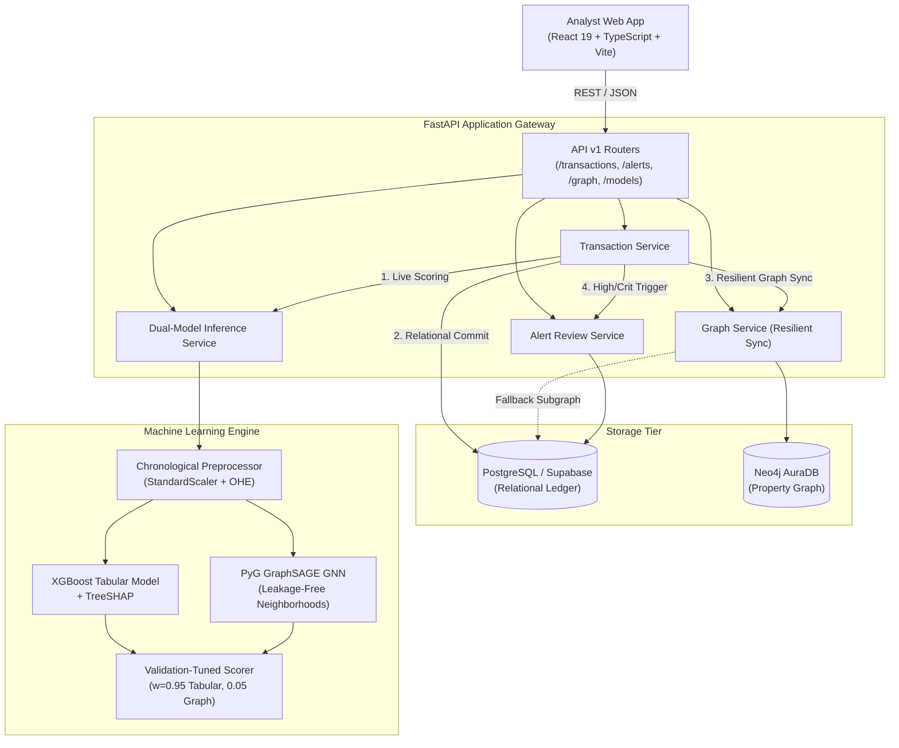

# FraudGraph: System Architecture & Design Specification

This document details the architectural design, data pipelines, graph models, machine learning systems, and frontend components of **FraudGraph**.

---

## 1. Executive Summary & Design Principles

FraudGraph is designed to bridge the gap between high-velocity tabular transaction scoring and relational entity-link analysis. Real-world fraud detection demands both millisecond-level scoring latency and multi-hop syndicate detection.

Key Architectural Tenets:
1. **Scientific Integrity**: Strict chronological data partitioning (`TransactionDT`) with no future information leakage or target-label contamination.
2. **Defensible Entity Modeling**: Real-world composite card fingerprints (`card1_card2_card3_card4_card5_card6`) and specific device/email hubs, rather than arbitrary pseudo-identifiers.
3. **Resilience by Design**: Dual-persistence strategy where PostgreSQL acts as the relational source of truth and Neo4j acts as the high-performance graph index, with automatic relational fallback if Neo4j is temporarily unreachable.
4. **Transparent Explainability**: Local tabular attributions via TreeSHAP paired with 2-hop structural subgraphs for investigator intuition.

---

## 2. End-to-End System Architecture



---

## 3. Data Ingestion & ML Pipeline

### 3.1 Chronological Partitioning
The IEEE-CIS dataset spans 182 days encoded via `TransactionDT` (seconds from reference epoch). To mirror real-world production conditions:
- **Train Split (70%)**: First 35,000 transactions ($t \le 812,652$). Fraud rate: 2.87%.
- **Validation Split (15%)**: Next 7,500 transactions ($812,652 < t \le 993,426$). Fraud rate: 2.81%. Used exclusively for early stopping, optimal classification threshold selection, and ensemble weight fitting.
- **Test Split (15%)**: Final 7,500 transactions ($t > 993,426$). Fraud rate: 1.91%. Strictly held out and evaluated only once.

### 3.2 Preprocessing & Feature Engineering
- **Numerical Features**: `TransactionAmt`, `dist1`, `C1`–`C14`, `D1`–`D15`, `V1`–`V339` (subset of non-degenerate signals). Imputed with training-set medians and scaled via fitted `StandardScaler`.
- **Categorical Features**: `ProductCD`, `card4` (network), `card6` (type), `P_emaildomain`, `R_emaildomain`, `DeviceType`. Frequency-encoded or one-hot encoded using training-set dictionaries only.
- **Composite Card Fingerprinting**: In IEEE-CIS, `card1` is a bank identification number (BIN), not a unique card. We construct composite card fingerprints:
  $$\text{CardFingerprint} = \text{card1}\_\text{card2}\_\text{card3}\_\text{card4}\_\text{card5}\_\text{card6}$$
- **Generic Email Hub Filtering**: Generic domains (`gmail.com`, `yahoo.com`, `hotmail.com`) are excluded from connecting unrelated transactions to prevent false-positive super-node connectivity.

---

## 4. Graph Construction & Graph Neural Network (GraphSAGE)

### 4.1 Neo4j Property Graph Schema

```
(:Transaction {id, amount, timestamp, risk_score, risk_level})
   |
   +--[:USED_CARD]--> (:Card {id: CardFingerprint})
   +--[:USED_DEVICE]--> (:Device {id: DeviceFingerprint})
   +--[:USED_EMAIL]--> (:Email {domain: SpecificDomain})
```

- Each node stores creation metadata and historical fraud flags.
- Transactions sharing the same card or device form 2-hop paths:
  $$(\text{Tx}_A) \xrightarrow{\text{USED\_CARD}} (\text{Card}_1) \xleftarrow{\text{USED\_CARD}} (\text{Tx}_B)$$

### 4.2 PyTorch Geometric (PyG) GraphSAGE
- **Nodes**: Transactions (35,000 train, 7,500 val, 7,500 test) and bipartite entity nodes.
- **Node Features**: Normalized transaction amounts, temporal deltas, and card attributes.
- **Zero-Leakage Safeguard**: Crucially, node features contain **zero target labels** (`isFraud`).
- **Masking**: Inductive training enforces loss computation strictly on `train_mask`. Validation evaluation occurs on `val_mask` to prevent transductive gradient flow.

---

## 5. Dual-Model Consensus Scoring

```python
# Validation-tuned ensemble
hybrid_score = (w_tabular * tabular_score) + (w_graph * graph_score)
```

Through grid search on the held-out validation set, optimal weights were determined as:
- $w_{\text{tabular}} = 0.95$
- $w_{\text{graph}} = 0.05$

### Risk Tier Thresholding
Tuned to preserve high recall while bounding false positives:
- **LOW**: $\text{score} < 0.0528$
- **MEDIUM**: $0.0528 \le \text{score} < 0.25$
- **HIGH**: $0.25 \le \text{score} < 0.70$
- **CRITICAL**: $\text{score} \ge 0.70$

Consensus logic flags a transaction as **CRITICAL** if the hybrid score exceeds the threshold, or if either model detects an extreme risk anomaly ($\ge 0.85$).

---

## 6. Backend Engineering & Database Resilience

### 6.1 Relational Schema (`PostgreSQL`)
- `transactions`: Stores primary transaction attributes, timestamps, amounts, risk decisions, and consensus reasoning.
- `alerts`: Stores investigation alerts with statuses (`PENDING`, `UNDER_REVIEW`, `RESOLVED`, `DISMISSED`), reviewer notes, and resolution timestamps.

### 6.2 Resilient Graph Synchronization
1. Transaction payload is scored via `ModelService`.
2. PostgreSQL transaction begins, writes transaction and alert record, and commits.
3. `GraphService` attempts asynchronous merge of transaction and entity nodes into Neo4j AuraDB.
4. If Neo4j times out or connection drops:
   - Error is logged cleanly without rolling back the financial ledger.
   - Relational ledger remains completely intact.
   - `GET /api/v1/graph/{id}` automatically falls back to generating a synthesized relational subgraph from PostgreSQL records.

---

## 7. Frontend Architecture (React 19 + TypeScript + Vite)

### View Hierarchy
1. **📊 Overview (`DashboardOverview`)**: High-level KPIs, active alert queue, recent transactions feed.
2. **💳 Transactions (`TransactionInvestigation`)**: Full-text search, risk filtering, server-side pagination, and slide-out transaction metadata drawer.
3. **🕸️ Graph Explorer (`RelationalGraphView`)**: High-performance SVG canvas supporting pan, zoom, node dragging, directed arrows, risk halo indicators, and node inspector drawer.
4. **⚡ Risk Inspector (`TransactionSimulator`)**: Interactive sandbox for testing transactions against live XGBoost, GNN, and TreeSHAP waterfall charts.
5. **📈 Benchmark (`BenchmarkDashboard`)**: Held-out chronological benchmark metrics, confusion matrices, and interactive ROC & PR curves.

